# SCS_4004_011 Module 7: Lab

From the document ***Lab Module 7 - Infrastructure as Code with Terraform.html***

Activity 1:

- Install Terraform.

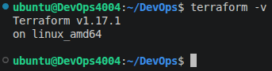

Activity 2:

- Provision a Local Docker Container.

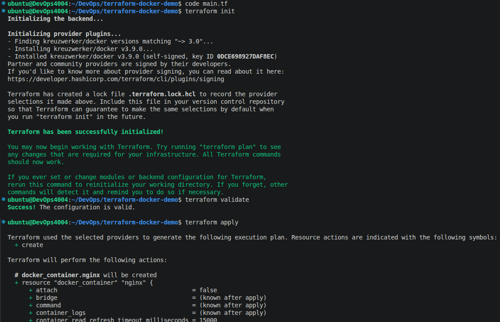

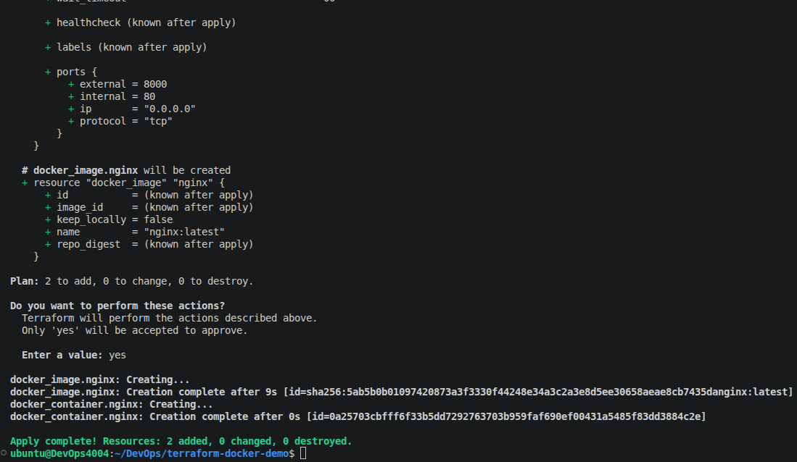

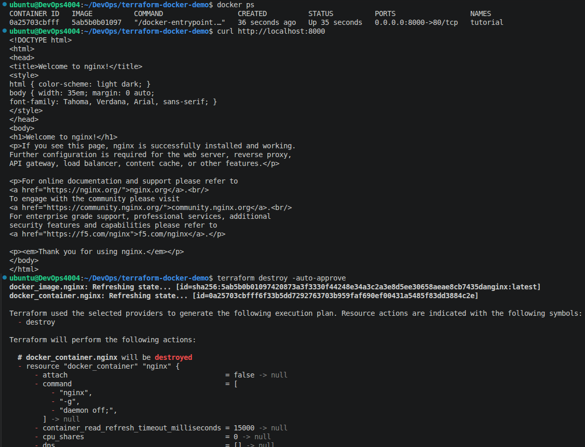

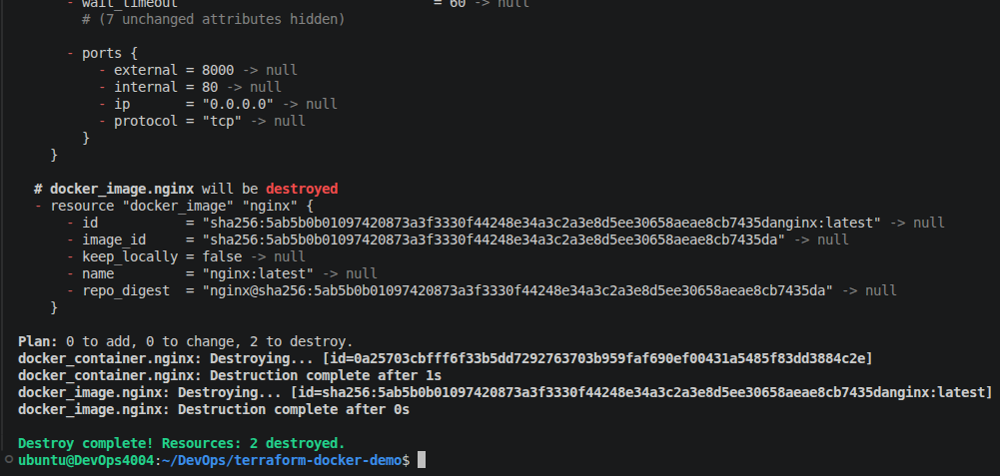

Activity 3:

- Provision Infrastructure for the Student Profile Stack.

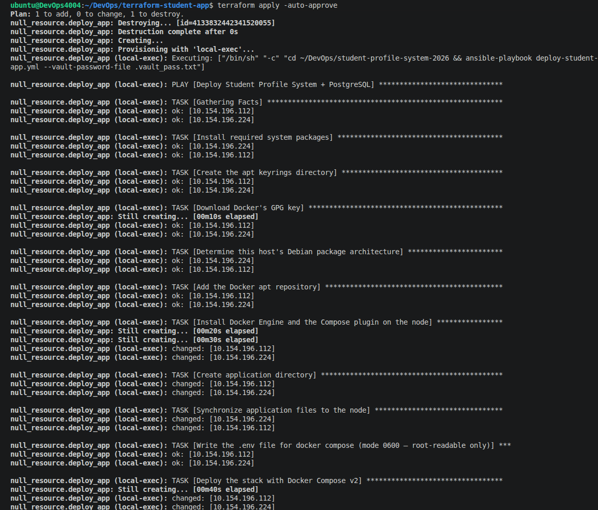

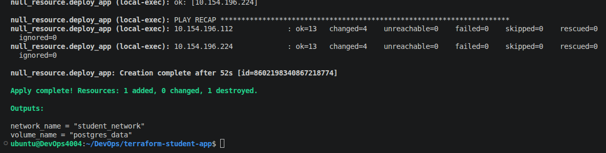

Activity 4:

- Provision Real Infrastructure on Google Cloud.

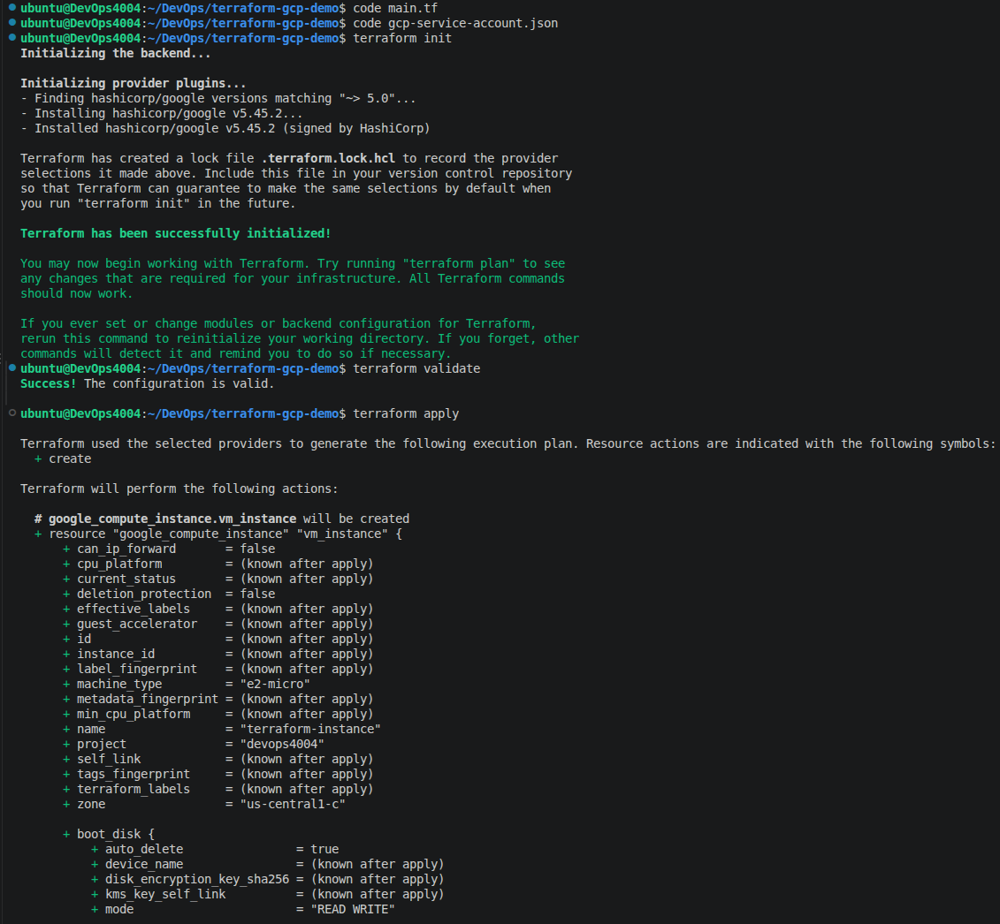

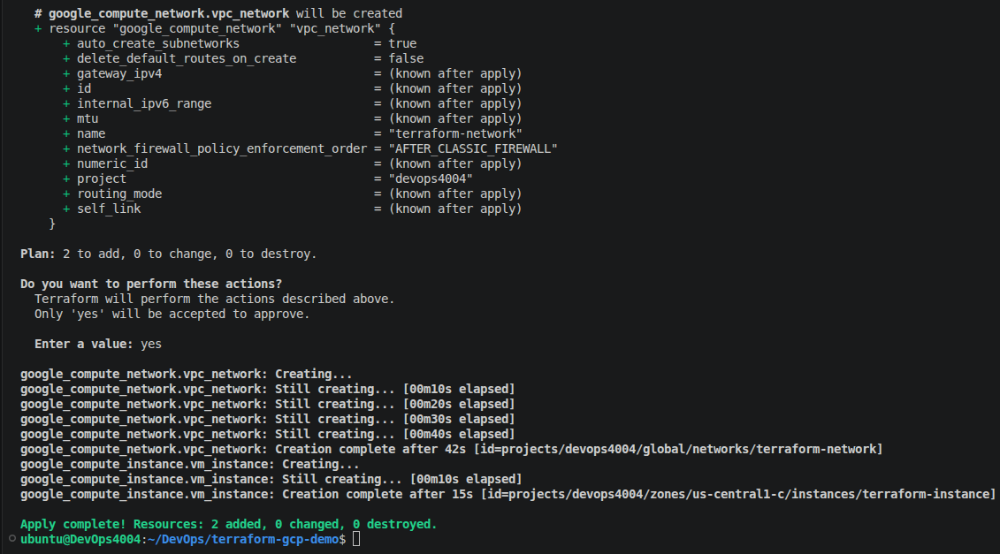

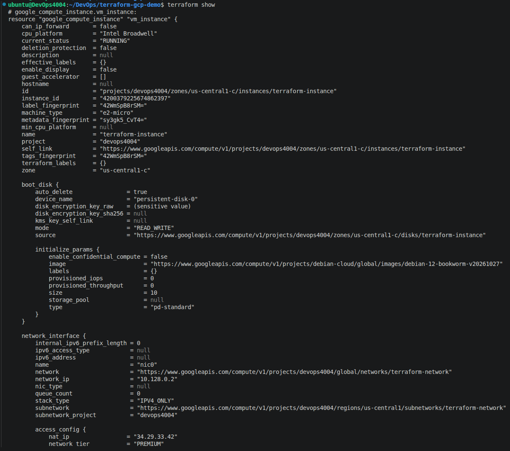

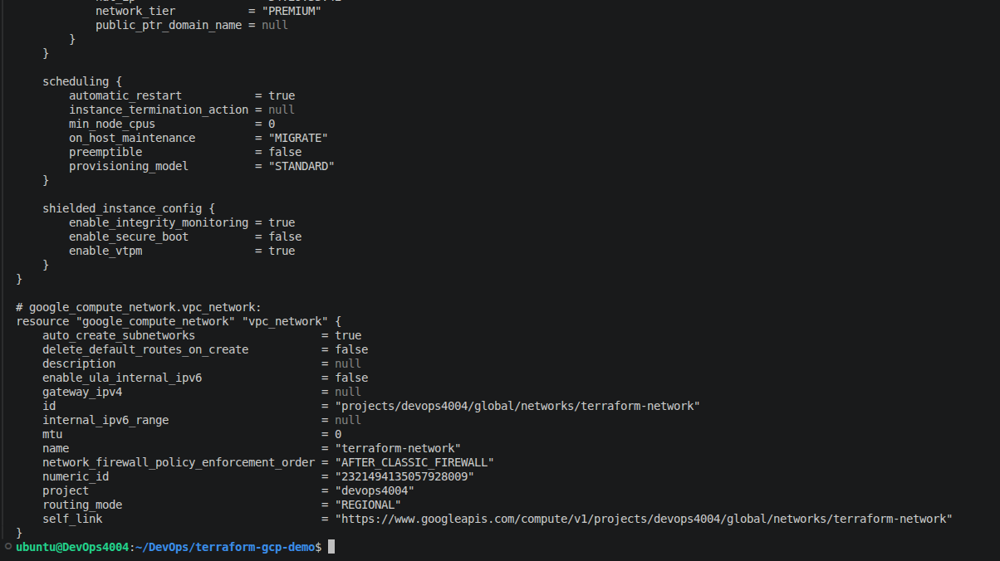

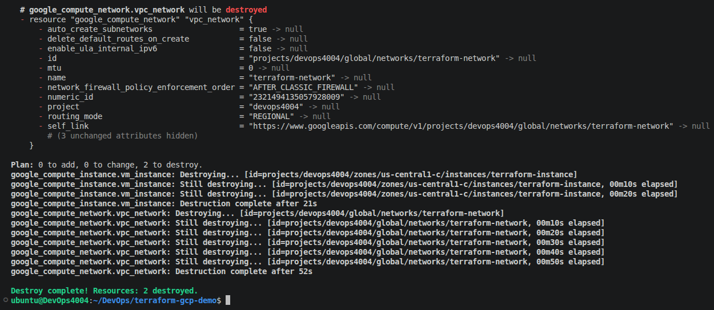
