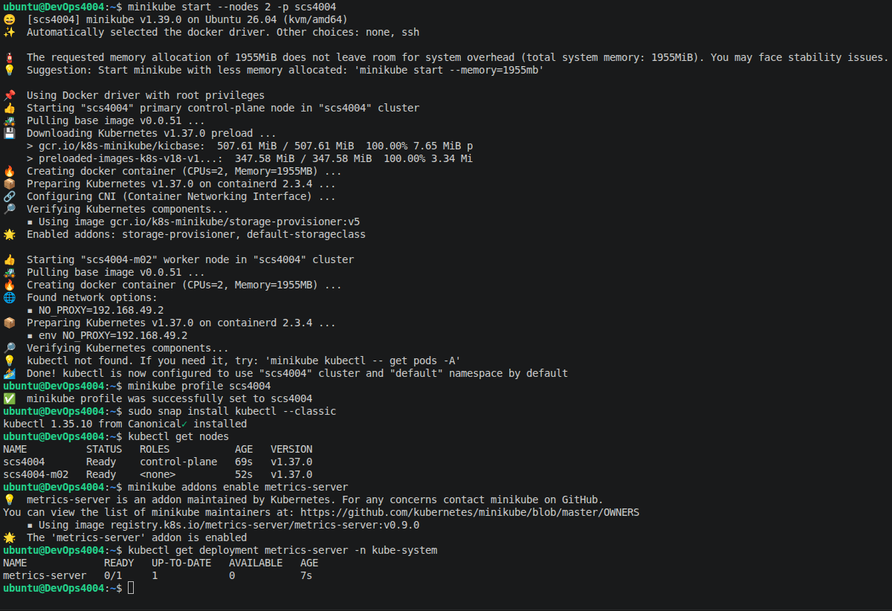
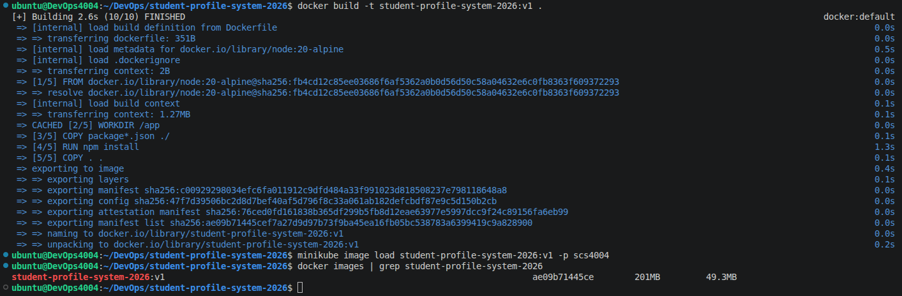
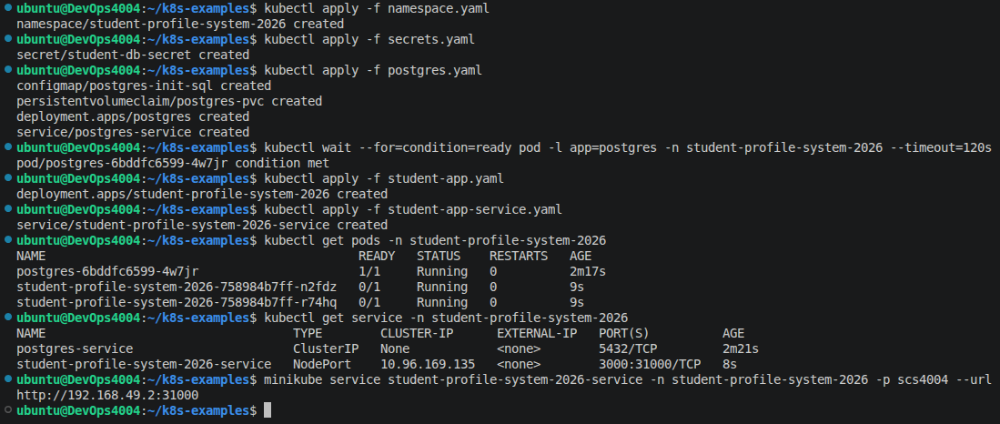
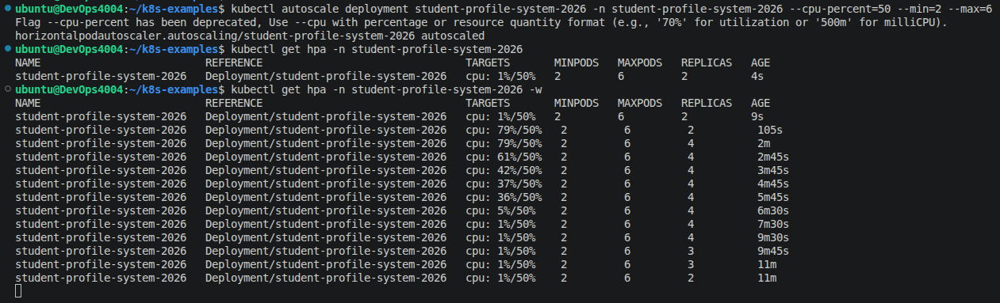
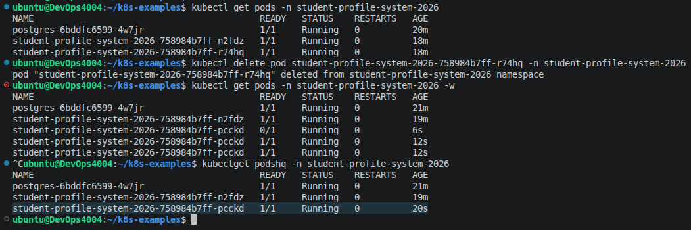

# SCS_4004_011 Module 8: Lab

From the document ***Lab Module 8 — Kubernetes Autoscaling.html***

Activity 1:

- Install and Start Minikube.

Activity 2:

- Build and Load Your Image.

Activity 3:

- Deploy PostgreSQL and the App.

Activity 4:

- Configure Real Autoscaling.

Activity 5:

- Self-Healing.

