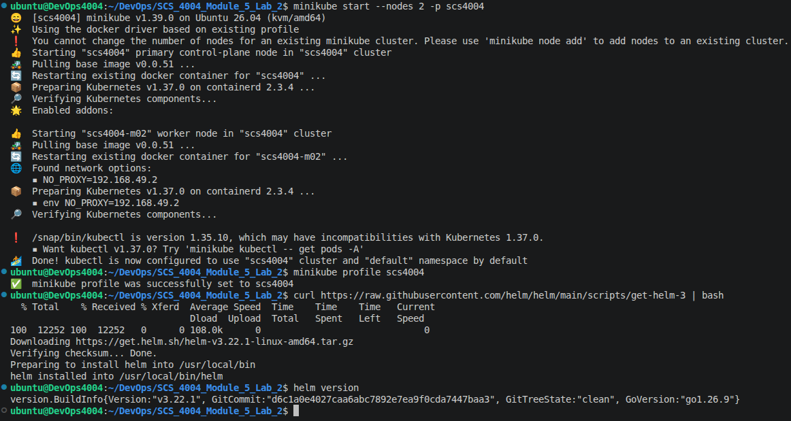
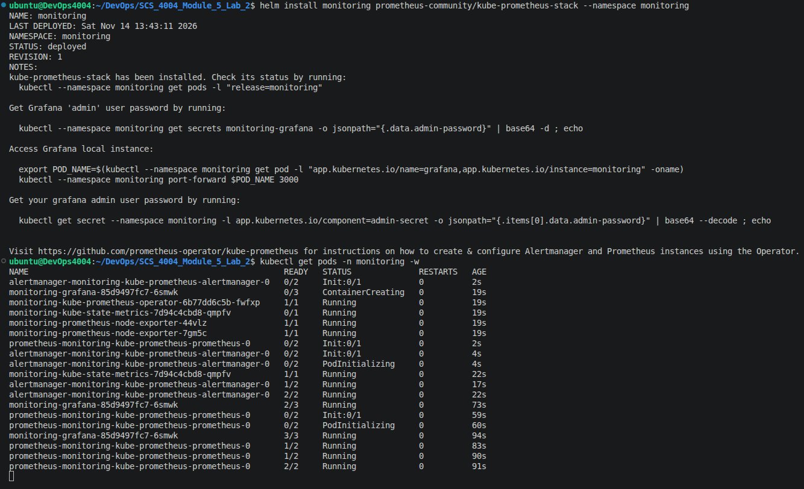
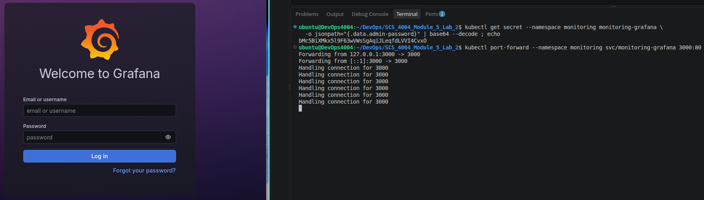
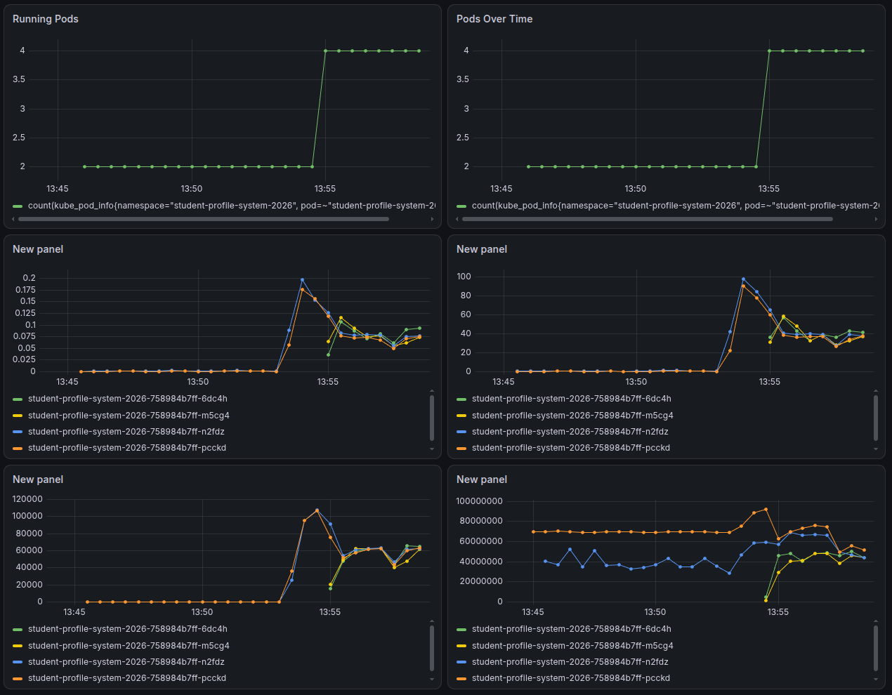
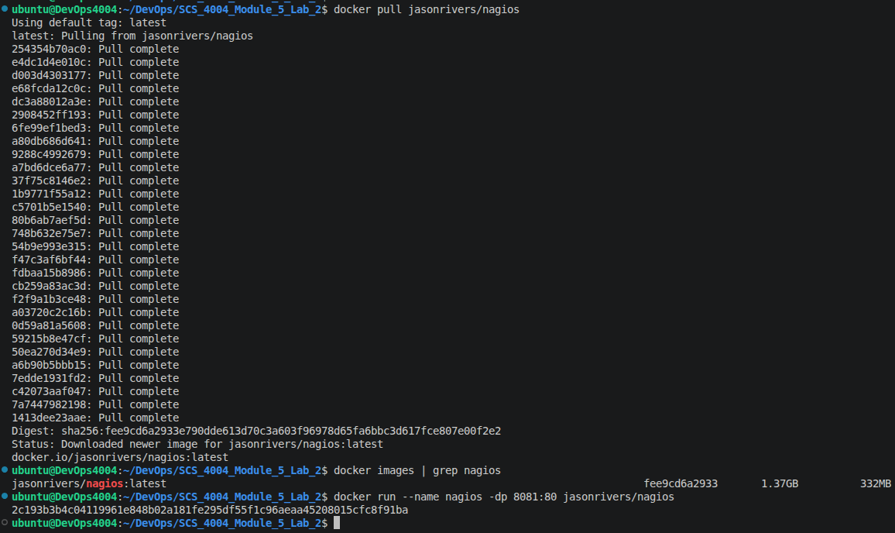
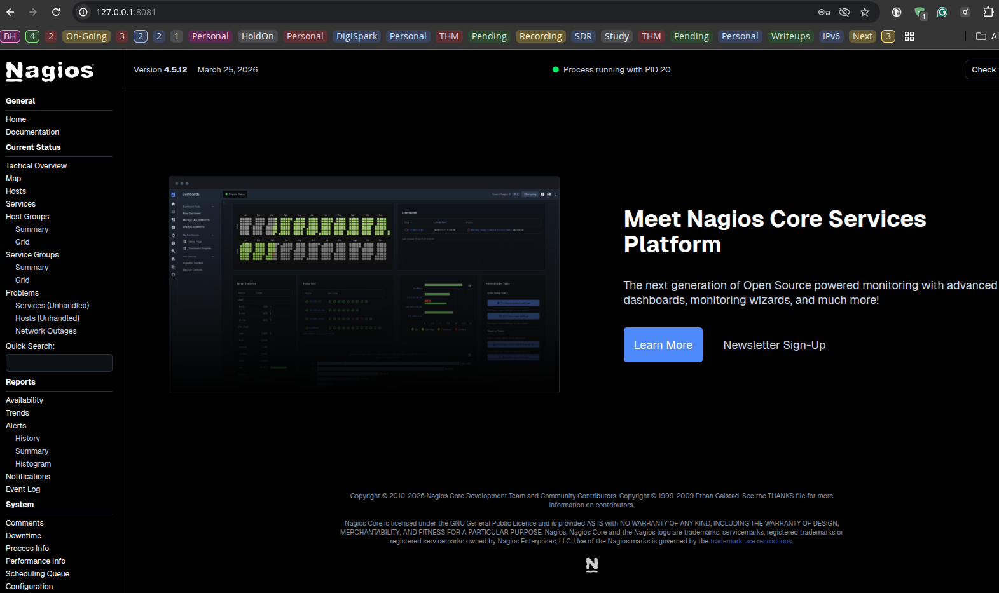
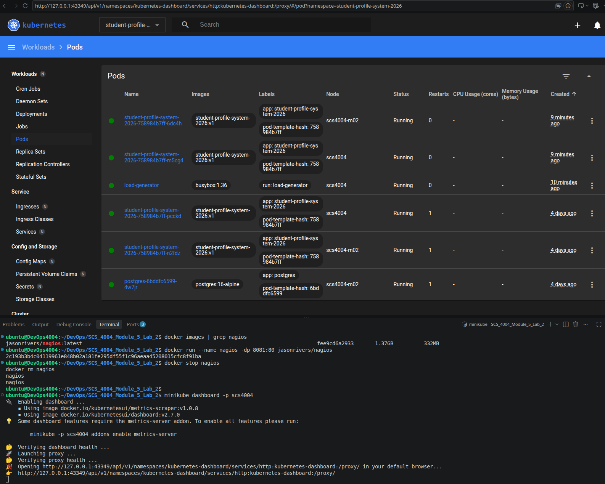

# SCS_4004_011 Module 9: Lab

From the document ***Lab Module 9 - Infrastructure & Application Monitoring.html***

Activity 1:

- Install Helm.

Activity 2:

- Install the Prometheus + Grafana Stack.

Activity 3:

- Open Grafana.

Activity 4 and 5:

- Build a Dashboard for Your App.
- Watch It React to Load.

Activity 6:

- Nagios via Docker.

Activity 7:

- Kubernetes Dashboard (built in, no sign-up).

